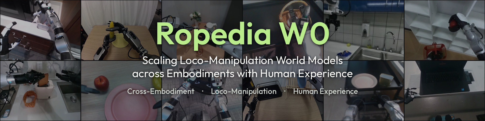

# Ropedia W0: Scaling Loco-Manipulation World Models across Embodiments with Human Experience

<a href="https://arxiv.org/abs/<ARXIV_ID>"></a>
<a href="https://ropedia.github.io/ropedia-w0/"></a>
<a href="https://youtu.be/<YOUTUBE_ID>"></a>
<a href="https://huggingface.co/ropedia-ai/Ropedia-W0"></a>
<a href="https://huggingface.co/datasets/ropedia-ai/Xp-Teleop"></a>
<a href="LICENSE"></a>

https://github.com/user-attachments/assets/97534c19-4310-48b5-bdc8-6d0d2867091d

**Ropedia W0** is an egocentric world foundation model that learns **loco-manipulation** from **10k hours of human experience** and transfers it across embodiments, from robot arms to humanoids and from grippers to dexterous hands, through **one shared kinematic interface** of camera poses and projected skeletons.

## 🔥 Highlights

- **Model: One World Model, Multiple Embodiments.** A unified egocentric loco-manipulation world foundation model spanning humans and diverse robots, from robotic arms to humanoids with grippers or dexterous hands, conditioned on camera poses and projected kinematic skeletons.
- **Data: 13K Hours of Unified Experience.** 10K hours of human and 3K hours of robot egocentric video, with metric camera trajectories, kinematic skeletons, and hierarchical captions.
- **Scaling: Scaling Human Experience to Robots.** More human pre-training data consistently improves world prediction for both humans and robots.
- **Performance: State of the Art Across Embodiments.** Leading results on five robot benchmarks and held-out human videos, spanning zero-shot, few-shot, and full-data post-training settings.
- **Applications: From Prediction to Interaction and Planning.** Supports real-time, minute-long interactive VR rollouts through distillation, alongside policy evaluation, model-based planning, and world-action modeling.

## 📝 To-Do List

- [x] Release technical report
- [x] Release inference code (5B)
- [x] Release 5B checkpoints, pre-trained and mid-trained ([Hugging Face](https://huggingface.co/ropedia-ai/Ropedia-W0))
- [x] Release Xp-Teleop teleoperation data ([Hugging Face](https://huggingface.co/datasets/ropedia-ai/Xp-Teleop))
- [ ] Release A14B checkpoints and inference code
- [ ] Release benchmark fine-tuned checkpoints (5B and A14B on Xp-Teleop, ω-HOME, Ψ0 and GR-1)
- [ ] Release evaluation code and benchmark data
- [ ] Release post-training code

## 🛠️ Installation

### Prerequisites
- **System:** Linux.
- **Hardware:** an NVIDIA GPU with at least 40 GB of memory for the 5B model (31 GB peak at 640×480, 81 frames). The code has been verified on H200.
- **Software:**
  - [Conda](https://docs.anaconda.com/miniconda/install/#quick-command-line-install) with Python 3.12.
  - An NVIDIA driver supporting CUDA 12.8. For CUDA 13 drivers see [ENVIRONMENT.md](ENVIRONMENT.md).
  - No custom CUDA extensions are needed; attention uses PyTorch SDPA.

### Installation Steps
1. Clone the repo:
    ```sh
    git clone https://github.com/Ropedia/ropedia-w0.git
    cd ropedia-w0
    ```
2. Create the environment and install the dependencies (torch 2.11 with CUDA 12.8):
    ```sh
    conda create -n ropedia-w0 python=3.12 -y
    conda activate ropedia-w0
    pip install torch==2.11.0 torchvision==0.26.0 --index-url https://download.pytorch.org/whl/cu128
    pip install -r requirements.txt
    ```
3. Download the Wan2.2 base model (VAE, text encoder and tokenizer):
    ```sh
    hf download Wan-AI/Wan2.2-TI2V-5B --local-dir models/Wan2.2-TI2V-5B
    ```
    Any other location works with `--base_model_dir` (or `BASE_MODEL_DIR` for the scripts).

## 📦 Pretrained Weights

The Ropedia W0 checkpoints are hosted on Hugging Face at [`ropedia-ai/Ropedia-W0`](https://huggingface.co/ropedia-ai/Ropedia-W0). Place them under `weights/` (or pass their paths to the scripts below).

| Model | Parameters | Training data | Resolution | File |
|---|---|---|---|---|
| Ropedia W0 5B (mid-trained) | 5B | human + robot video | 640×480, 81 frames | `w0-5b-midtrain.safetensors` |
| Ropedia W0 5B (pre-trained) | 5B | human egocentric video | 640×480, 81 frames | `w0-5b-pretrain.safetensors` |

## 🚀 Inference
Run inference on one clip with the provided script. [`examples/`](examples/README.md) ships 18 ready-to-run clips from Xp-Teleop, ω-HOME, AgiBot World, GR-1 and human egocentric video (Xperience-10M, EgoDex, OpenAoE):
```bash
CFG=3.0 FPS=30 bash scripts/run_single_case_5b.sh examples/xp_teleop_playdoh_tub weights/w0-5b-midtrain.safetensors outputs/playdoh_tub
# robot clips: CFG=3.0 FPS=30 (GR-1 clips also NUM_FRAMES=49 FPS=10); human clips: the defaults (cfg 5.0, fps 16)
```
A clip directory holds `video.mp4` (its first frame conditions the model), `data.npz` (camera intrinsics and camera-to-world poses), `skeleton.mp4` (the rendered skeleton condition) and `prompt.txt`. To render `skeleton.mp4` from human hand keypoints, run `python tools/render_skeleton.py [CLIP_DIR]`.

The script runs `inference_5b.py` with the following arguments:
```bash
python inference_5b.py \
    --video [CLIP_DIR]/video.mp4 \
    --camera_params [CLIP_DIR]/data.npz \
    --skeleton_video [CLIP_DIR]/skeleton.mp4 \
    --prompt [TEXT_PROMPT] \
    --ckpt [CKPT] \
    --num_frames 81 --height 480 --width 640 --fps [FPS] \
    --cfg_scale [CFG] --num_inference_steps 50 --seed 0 \
    --output_dir [OUTPUT_DIR]
```
#### Key Arguments:
🎥 Conditions
- `--camera_params`: `data.npz` with per-frame intrinsics and camera-to-world poses (OpenCV convention); poses are taken relative to the first frame of the window.
- `--skeleton_video`: skeleton condition video on a black background, frame-aligned with the window.
- `--scene_scale`: multiplier on the camera translation (default 1.0).
- `--disable_camera` / `--disable_skeleton`: run without one of the conditions.

🎬 Window and sampling
- `--num_frames`, `--height`, `--width`: 81 frames at 640×480 for the released checkpoints.
- `--start_frame`: first frame of the window in the source video (default 0).
- `--fps`: frame rate of the written videos (16 for human egocentric data, 30 for robot data).
- `--cfg_scale`, `--num_inference_steps`, `--seed`: sampling settings; we use 50 steps, seed 0, and cfg 5.0 on human video / 3.0 on robot data.

📦 Checkpoints
- `--ckpt`: the Ropedia W0 checkpoint (a full DiT state dict, `--ckpt_type full`).
- `--base_model_dir`: local download of Wan-AI/Wan2.2-TI2V-5B (default `models/Wan2.2-TI2V-5B`).

#### Input Format
A clip directory holds:

| File | Content |
|---|---|
| `video.mp4` | RGB, 640×480, 81 frames. Only the first frame conditions the model; the other frames are kept as the reference (`video_gt.mp4`). |
| `data.npz` | `extrinsics_c2w` (T,4,4): camera-to-world poses, OpenCV convention; `intrinsics` (T,3,3) in pixels. |
| `skeleton.mp4` | Skeleton condition video on a black background, frame-aligned with `video.mp4`. For human hands, store `hand_kp` (T,2,21,2) pixel keypoints in `data.npz` and run `python tools/render_skeleton.py [CLIP_DIR]`. |
| `prompt.txt` | Text prompt. |

Batch inference over a CSV (`--data_root`, `--metadata`, `--idx`) loads the model once per process; see `python inference_5b.py --help`.

## ⚖️ License

- **Code:** [Apache License 2.0](LICENSE).
- **Model weights:** [CC BY-NC 4.0](https://creativecommons.org/licenses/by-nc/4.0/).
- **Xp-Teleop data:** [CC BY 4.0](https://creativecommons.org/licenses/by/4.0/).

The Wan2.2 base model and the source datasets of the example clips remain subject to their original licenses.

## 📚 Citation

```bibtex
@article{liu2026ropedia,
  title={Ropedia W0: Scaling Loco-Manipulation World Models across Embodiments with Human Experience},
  author={Liu, Tianqi and Zhao, Hanfei and Liang, Qifeng and Pang, Hui En and Xu, Jiarui and Mu, Sayang and Qiu, Penghao and Zhang, YingSheng and Wang, Jun and Cao, Ziang and Sun, Mingze and Cao, Yukang and Hong, Fangzhou and Chen, Zhaoxi and Liu, Ziwei},
  journal={arXiv preprint arXiv:<ARXIV_ID>},
  year={2026}
}
```

## 🙏 Acknowledgments

We thank the authors of the following projects and datasets.

<details>
<summary><b>Base model and code</b> — click to expand</summary>

- [Wan2.2](https://github.com/Wan-Video/Wan2.2)
- [DiffSynth-Studio](https://github.com/modelscope/DiffSynth-Studio)
- [Depth Anything 3](https://github.com/ByteDance-Seed/Depth-Anything-3)
- [WiLoR](https://github.com/rolpotamias/WiLoR)

</details>

<details>
<summary><b>Human egocentric datasets</b> — click to expand</summary>

- [Xperience-10M](https://huggingface.co/datasets/ropedia-ai/xperience-10m)
- [Ego4D](https://ego4d-data.org/)
- [Ego-Exo4D](https://ego-exo4d-data.org/)
- [EgoDex](https://github.com/apple/ml-egodex)
- [EPIC-KITCHENS](https://epic-kitchens.github.io/)
- [HoloAssist](https://holoassist.github.io/)
- [Egocentric-10K](https://huggingface.co/datasets/builddotai/Egocentric-10K)
- [EgoVerse](https://arxiv.org/abs/2604.07607)
- [HOI4D](https://hoi4d.github.io/)
- [EgoPAT3Dv2](https://github.com/ai4ce/EgoPAT3Dv2)
- [ARCTIC](https://arctic.is.tue.mpg.de/)
- [H2O](https://taeinkwon.com/projects/h2o/)
- [TACO](https://taco2024.github.io/)
- [FPHA](https://guiggh.github.io/publications/first-person-hands/)
- [EgoSuite](https://huggingface.co/collections/LightwheelAI/egosuite-open100k)
- [OpenAoE](https://huggingface.co/datasets/inclusionAI/OpenAoE-2000h)

</details>

<details>
<summary><b>Robot datasets</b> — click to expand</summary>

- [AgiBot World](https://github.com/OpenDriveLab/AgiBot-World)
- [DROID](https://droid-dataset.github.io/)
- [RH20T](https://rh20t.github.io/)
- [Fourier ActionNet](https://huggingface.co/datasets/FourierIntelligence/ActionNet)
- [GR00T-Teleop-GR1](https://huggingface.co/datasets/nvidia/PhysicalAI-Robotics-GR00T-Teleop-GR1)
- [Humanoid Everyday](https://humanoideveryday.github.io/)
- [UnifoLM-WBT](https://huggingface.co/collections/unitreerobotics/unifolm-wbt-dataset)
- [HumanPlus](https://humanoid-ai.github.io/)
- [HIW-500](https://bitrobot-foundation.github.io/humanoids-in-the-wild-500-hours/)
- [Dexora](https://arxiv.org/abs/2605.18722)
- [DECO](https://arxiv.org/abs/2602.05513)
- [T-Rex](https://arxiv.org/abs/2606.17055)
- [VTouch++](https://arxiv.org/abs/2604.20444)
- [Ψ0](https://huggingface.co/datasets/USC-PSI-Lab/psi-data)
- [ω-HOME](https://huggingface.co/datasets/keycharon/omega-HOME)
- [DreamDojo](https://github.com/NVIDIA/DreamDojo)
- [LIBERO](https://github.com/Lifelong-Robot-Learning/LIBERO)

</details>
